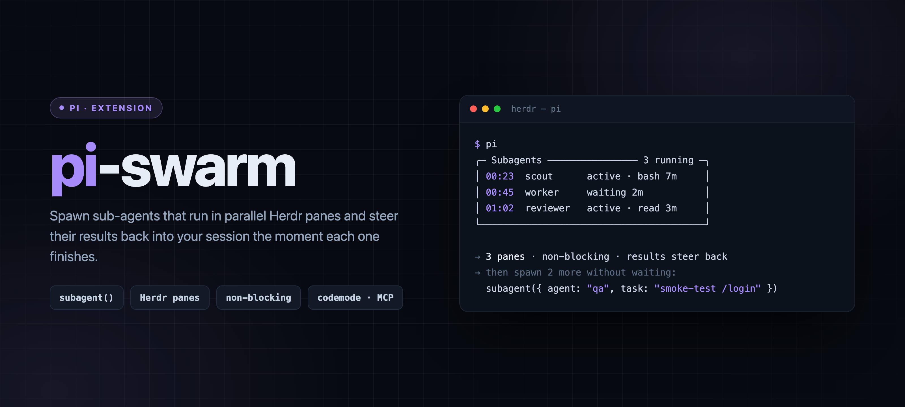

# pi-swarm

<p align="center">
  
</p>

Async, interactive subagents for Pi, running in **Herdr** panes.

`subagent()` returns immediately. The sub-agent runs in its own Herdr pane
(split right off the parent pane, `--no-focus`, so pane creation never steals
keyboard focus). A live widget above the input tracks every running sub-agent,
and when one finishes, its result is steered into the main session as a
notification that triggers a new turn. Fully non-blocking.

```
╭─ Subagents ──────────────── 2 running ─╮
│ 00:23  scout      active · bash 7m     │
│ 00:45  worker     waiting 2m           │
╰────────────────────────────────────────╯
```

Spawn several in parallel — they run concurrently and steer results back
independently as each finishes.

## Tools

| Tool | Description |
| --- | --- |
| `subagent` | Spawn a sub-agent in a dedicated Herdr pane (async) |
| `subagent_message` | Message a sub-agent by name — steers it if running, resumes its session if finished |
| `subagents_list` | List available agent definitions |
| `ask_question` | *(sub-agent sessions only)* Ask the orchestrator a question and wait for the reply |

There is also a `/subagent <agent> <task>` command for spawning directly.

```typescript
subagent({ agent: "scout", task: "Analyze the auth module" });
subagent({ agent: "worker", name: "dark-mode", task: "Implement the dark mode toggle" });
```

## Bundled agents

| Agent | Model | Tools | Role |
|-------|-------|-------|------|
| **scout** | `opencode-go/deepseek-v4-flash` | read, grep, find, ls | Fast read-only recon |
| **researcher** | `opencode-go/deepseek-v4.1-flash` | web_search, web_fetch, safe_bash, codemode, mcp__firecrawl__* | Web research → sourced brief |
| **worker** | `opencode-go/deepseek-v4.1-flash` | read, write, edit, bash, web_search, web_fetch (+ spawns scout/researcher/qa) | Implementer |
| **reviewer** | `opencode-go/muse-spark-1.3-contributor` | read, grep, find, ls, safe_bash | Read-only code review |
| **planner** | `google-vertex/gemini-4-argon` | read, write, grep, find, ls, safe_bash (+ spawns scout/researcher) | Architecture spec to `.pi/plans/`, never code |
| **qa** | `opencode-go/deepseek-v4.1-flash` | read, grep, find, ls, safe_bash, codemode, mcp__playwright_chrome__*, mcp__playwright_webkit__* | Web-app QA via Playwright MCP |

Model rationale:

- **scout** — mechanical locate-and-report. `deepseek-v4-flash` is the cheapest,
  fastest model with a 1M window; matches the low-thinking recon job.
- **researcher / worker** — agentic, multi-step, long outputs. `deepseek-v4.1-flash`
  has a 384K output budget and strong tool use.
- **planner** — read-only over code, writes only a spec. `max` thinking, because a
  wrong interface in the spec costs a whole implementation.
- **reviewer** — read-only, bounded output. `muse-spark-1.3-contributor` is an
  affordable 1M-context model; review is a good fit for a cheaper tier.

Override per spawn with `subagent({ agent, model })`, or edit the frontmatter.

### MCP in subagents

Subagents are sandboxed with `--no-extensions`, so MCP is **off by default**. An
agent opts in by listing `codemode` plus MCP tools in its `tools` frontmatter
(`mcp__<server>__*` patterns or explicit names). The extension then launches the
child with `-e builtin:codemode -e builtin:mcp`, and the agent reaches the
servers through `codemode` scripts.

Using `codemode` is deliberate for token efficiency: only the script's output
enters the agent's context, so large browser accessibility snapshots never pile
up in it. See `agents/qa.md` for the pattern.

## Custom agents

Place a `.md` file in `.pi/agents/` (project) or `~/.pi/agent/agents/` (global).
Discovery priority: project > global > package-bundled.

```markdown
---
name: my-agent
description: Does something specific
model: opencode-go/deepseek-v4.1-flash
thinking: medium
tools: read, edit, write, safe_bash, web_search
session-mode: lineage-only
auto-exit: true
---

You are a specialized agent that does X...
```

Key frontmatter fields: `model`, `thinking`, `tools` (strict allowlist),
`subagent_agents` (which agents this one may spawn; presence grants the spawning
tools), `skills`, `session-mode` (`standalone` | `lineage-only` | `fork`),
`system-prompt` (`append` | `replace`), `auto-exit`, `cwd`.

## Identifying agents

Every spawned pane is **renamed to the subagent's display name**, so the Herdr
tab bar / sidebar shows `scout`, `scout-2`, `worker`, …. The status widget above
the input lists names too. From the CLI: `herdr pane list`, `herdr agent list`,
`herdr agent get <name>`, `herdr agent read <name>`.

## Command calls

Run a process instead of an agent — a test suite, a build, a long `sleep` — with
no model, no session, zero tokens:

```typescript
subagent({ name: "tests", command: ["npm", "test"], timeoutMs: 600_000 });
subagent({ name: "lint", command: "npm run lint && npm run typecheck" });
```

An array runs that program (argv, no shell syntax); a string runs through
`/bin/sh`. Output goes to `artifacts/<session>/subagent-output/<name>.log` and
the result is its last 6 000 characters. A command has no session, so it cannot
be resumed or steered.

## Timeouts

Unset by default (wait forever). Set `timeoutMs` per spawn, or `timeout: 15m`
in agent frontmatter (`90s`/`30m`/`2h`; a bare number is milliseconds). On
timeout the pane is closed and the phase is `timeout`, not a crash. Waiting on
a question does not count against the budget.

## Model fallbacks

```markdown
model: openrouter/z-ai/glm-5.3-flash
models: openrouter/z-ai/glm-5.3-flash, openrouter/anthropic/claude-haiku-4.5
```

Retried on the next model only for provider errors another model can fix (usage
limit, quota, overload, 429). Billing failures fail at once, an ordinary crash
is never retried, and the failover continues the **same child session** so
landed work is not redone. One failover per run.

## Writer conflicts

A spawn that may `edit`/`write` is recorded as a writer of its worktree; if
another live subagent of this session already writes there, the acknowledgement
says so. A warning, not a lock — parallel workers in one checkout are the point.
Other pi sessions in the same worktree are not compared.

## Surviving a restart

The registry is a durable record: every spawn writes its pane, agent, model,
task and start time before the pane command is sent, and every phase change and
exit updates it. After the parent quits or is killed, the next session on that
session file reads the rows back:

- **still running** → its pane is adopted, the widget row returns, and its
  result is still delivered;
- **finished while nobody listened** → the stored result is replayed once;
- **unknown** (pane gone, no result) → reported as unknown, never guessed and
  never re-run.

A session that ends stops its subagents (no unattended spending) and leaves them
unreported, so the next session says what was interrupted. Resume one by name
with `subagent_message({ name })`.

## Requirements

- Pi running inside Herdr (`HERDR_ENV=1`)
- Extension auto-discovers from `~/.pi/agent/extensions/pi-swarm/`
- `npm test` runs the reconcile/registry tests (Node ≥ 22.19, no build step)

## Checks

CI runs `npm run typecheck` and `npm test` on pull requests and on `main`.

Not covered by CI, worth one manual pass after a change to the launch or
reconcile path:

- spawn a subagent, let it finish → the result arrives on its own;
- quit pi while one runs → the next session says once what was `stopped`;
- `kill -9` the parent mid-run → the next session adopts the pane and still
  delivers the result;
- clear the child pane after it finished, then reopen → the result comes back
  with "exit code lost" instead of being lost.

## Reference

- Herdr CLI: `herdr --skill`

## License

MIT. See [LICENSE](./LICENSE).
